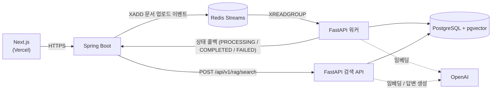
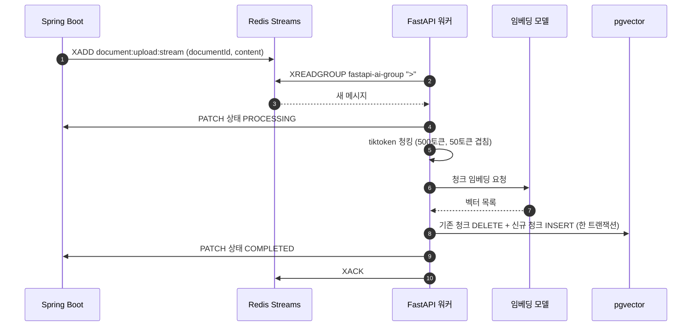
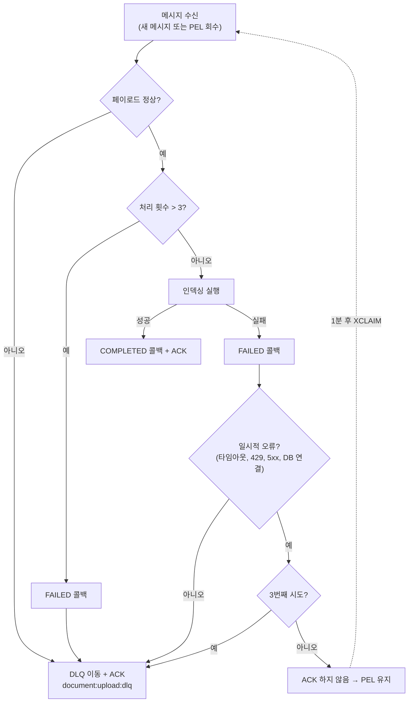
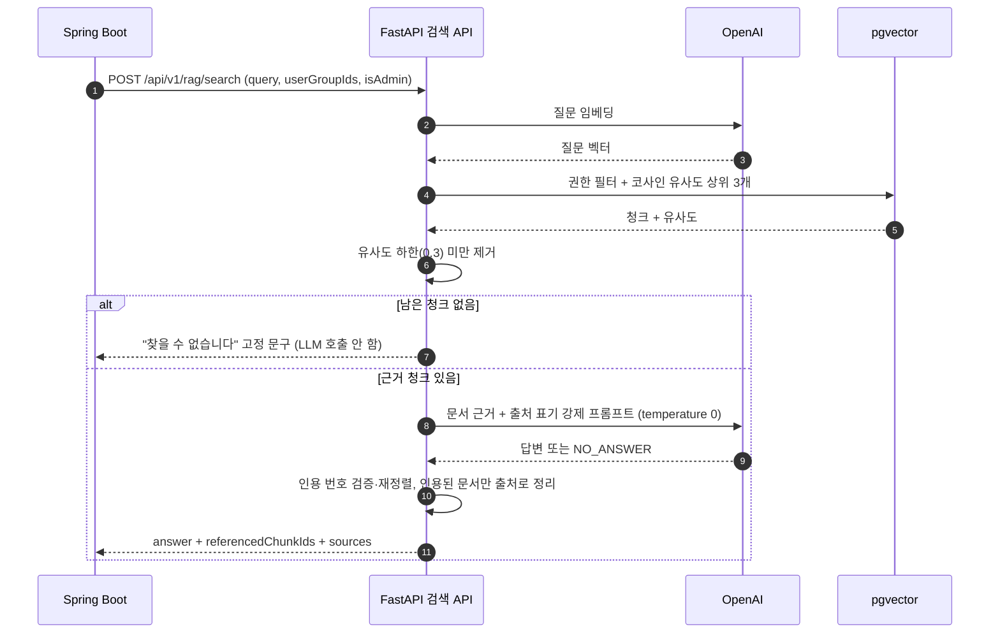
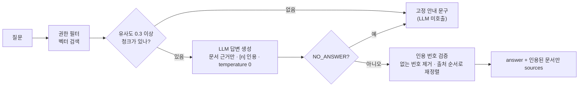
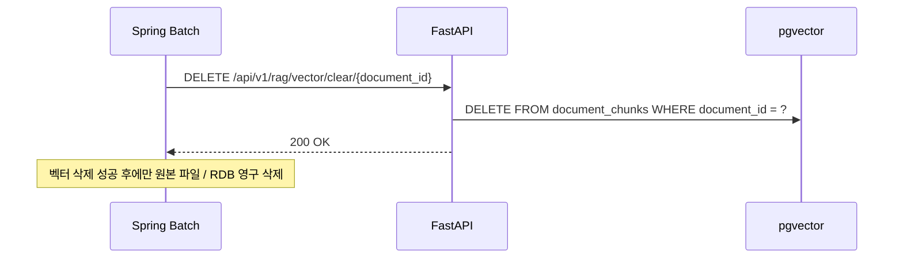
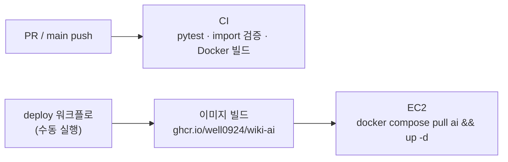

# RAG 기반 사내 위키 검색 에이전트 (AI Server)

> Python · FastAPI · Redis Streams · pgvector · SentenceTransformers · OpenAI

---

## 📌 프로젝트 개요

사내 문서를 업로드하면 AI가 자동으로 청킹·임베딩하여 벡터 DB에 인덱싱하고,
임직원이 자연어로 질의하면 소속 부서 권한 기반으로 필터링된 문서만 참조하여 답변을 생성하는
RAG(Retrieval-Augmented Generation) 기반 사내 위키 검색 서버입니다.

- **Spring Boot 백엔드 저장소**: [rag_wiki_project_backend](https://github.com/well0924/rag_wiki_project_backend)

### 역할 분담

| 구분 | Spring Boot (Kotlin) | FastAPI (Python, 이 저장소) |
|---|---|---|
| 인증 / 권한 | JWT, 구글 로그인, 부서 그룹 권한 판정 | 전달받은 그룹 ID로 검색 범위 제한 |
| 문서 | 업로드 검증, 텍스트 추출, 원본 저장, 상태 관리 | 청킹, 임베딩, pgvector 적재 |
| 검색 | 검색 기록 / 피드백 저장 | 벡터 검색, LLM 답변 생성, 환각 방지 |
| 테이블 소유 | `documents`, `document_permissions` 등 | `document_chunks` |



> Spring ↔ FastAPI 간 호출은 모두 `X-Internal-Api-Key` 공유 키로 인증하며, 외부에서는 FastAPI에 직접 접근할 수 없습니다.

---

## 🛠️ 기술 스택

| 구분 | 기술 |
|---|---|
| Language | Python 3.11 |
| Framework | FastAPI |
| Message Queue | Redis Streams (Consumer Group, PEL 재처리, DLQ) |
| Vector DB | pgvector (PostgreSQL) |
| Embedding (Local) | SentenceTransformers `distiluse-base-multilingual-cased-v1` (512차원) |
| Embedding (Production) | OpenAI `text-embedding-3-small` (1536차원) |
| LLM | OpenAI `gpt-4o-mini` |
| Tokenizer | tiktoken (`cl100k_base`) |
| ORM | SQLAlchemy (비동기, asyncpg) |
| Test / CI | pytest · GitHub Actions · Docker |

---

## 📁 패키지 구조

```
app/
├── config.py              ← Pydantic Settings (환경변수 관리)
├── database.py            ← 비동기 DB 엔진, DocumentChunkEntity, 기동 시 테이블/차원 검증
├── main.py                ← FastAPI 앱 진입점, Redis Streams 워커 시작
├── security.py            ← 서버 간 공유 키(X-Internal-Api-Key) 검증
├── routers/
│   └── search.py          ← RAG 검색 엔드포인트, 벡터 청크 삭제 엔드포인트
├── service/
│   ├── rag_service.py     ← 청킹, 임베딩, pgvector 저장, 권한 필터 검색, LLM 답변 생성(환각 방지)
│   └── worker.py          ← Redis Streams 컨슈머 (상태 콜백, 재시도, DLQ)
└── utile/
    └── embedding.py       ← 로컬 SentenceTransformer 모델 관리 (local 모드에서만 로드)
tests/                     ← pytest 단위 테스트
```

### API

| 메서드 | 경로 | 호출 주체 | 설명 |
|---|---|---|---|
| `POST` | `/api/v1/rag/search` | Spring 검색 API | 권한 필터 검색 + 답변 생성 (`answer`, `referencedChunkIds`, `sources`) |
| `DELETE` | `/api/v1/rag/vector/clear/{document_id}` | Spring Batch | 영구 삭제 대상 문서의 벡터 청크 제거 |
| `GET` | `/` | 헬스체크 | Docker HEALTHCHECK 용 |

---

## 📎 지원 파일 형식 (MVP)

| 형식 | 확장자 | 비고 |
|---|---|---|
| 텍스트 | `.txt` | 기본 텍스트 문서 |
| PDF | `.pdf` | 사내 가이드, 규정 문서 등 |
| Word | `.docx` | 기획서, 회의록 등 |
| Markdown | `.md` | README, ADR, 포스트모템 등 |

> Spring Boot가 업로드 시 형식을 검증하고 텍스트를 추출한 뒤 본문을 Redis Streams에 발행합니다.
> 이 서버는 추출된 텍스트만 받으므로 파일 형식과 무관하게 동일한 파이프라인으로 처리합니다.

---

## 🔄 문서 인덱싱 파이프라인

Spring Boot 백엔드가 문서 업로드 시 Redis Streams에 이벤트를 발행하면,
FastAPI AI 워커가 이를 소비하여 벡터 인덱싱을 수행합니다.



- 같은 문서가 다시 들어와도 기존 청크를 지우고 다시 적재하므로(멱등성) 청크가 중복되지 않습니다.
- 임베딩은 개발 환경에서 로컬 모델, 운영 환경에서 OpenAI API를 사용합니다 (`EMBEDDING_PROVIDER`).

### 실패 처리 (재시도 / DLQ)

처리에 실패한 메시지는 ACK 하지 않아 Consumer Group의 PEL(Pending Entries List)에 남습니다.
`XREADGROUP >`는 새 메시지만 읽기 때문에, 워커가 30초마다 PEL을 점검해 1분 이상 ACK 되지 않은 메시지를 `XCLAIM`으로 다시 가져옵니다.



| 상황 | 처리 |
|---|---|
| 일시적 오류 (네트워크, 타임아웃, OpenAI 429/5xx, DB 연결) | ACK 하지 않음 → 1분 뒤 재처리 (최초 포함 최대 3회) |
| 3회 모두 실패 | `document:upload:dlq` 스트림으로 이동 후 ACK |
| 재시도해도 결과가 같은 오류 (잘못된 입력, 벡터 차원 불일치 등) | 즉시 DLQ로 이동 |
| 페이로드 누락 (`documentId`/`content` 없음) | 즉시 DLQ로 이동 (상태 콜백 없음) |
| 처리 중 워커 종료 | 재기동 후 PEL에서 회수하여 재처리 |

- 실패할 때마다 Spring에 `FAILED`를 알리고, 재시도에 성공하면 `FAILED → PROCESSING → COMPLETED`로 복구됩니다.
- DLQ 메시지에는 원본 필드와 함께 `originalMessageId`, `reason`, `failedAt`이 남아 원인 확인 후 재발행할 수 있습니다 (최근 1,000건 보관).
- `XPENDING`의 `IDLE` 옵션은 Redis 6.2+ 전용이라, 로컬(Redis 5)에서도 동작하도록 경과 시간은 코드에서 직접 비교합니다.

### 동작 캡처

> FastAPI 워커 기동 및 문서 인덱싱 완료 로그


> Redis Streams 및 캐시 적재 확인


---

## 🔍 RAG 검색 파이프라인



### 권한 기반 필터링 쿼리

```sql
SELECT dc.id, dc.document_id, d.title, dc.content,
       1 - (dc.embedding <=> :query_vector) AS similarity
FROM public.document_chunks dc
INNER JOIN public.documents d ON d.id = dc.document_id
WHERE d.is_deleted = false
  AND (
      CAST(:is_admin AS boolean)
      OR EXISTS (
          SELECT 1 FROM public.document_permissions dp
          WHERE dp.document_id = dc.document_id
            AND dp.group_id = ANY(:group_ids)
      )
  )
ORDER BY dc.embedding <=> :query_vector
LIMIT :limit
```

- 사용자의 `group_ids`로 접근 가능한 문서만 유사도 검색 대상에 포함시켜 타 부서 문서가 답변에 노출되지 않도록 합니다.
- 권한 확인을 `JOIN` 대신 `EXISTS`로 수행하여, 여러 허용 그룹에 걸친 문서의 청크가 중복 반환되지 않습니다.
- Soft Delete된 문서(`is_deleted`)는 배치로 벡터가 파기되기 전이라도 즉시 검색에서 제외됩니다.
- 관리자(`is_admin`)는 그룹 필터 없이 전사 문서를 검색합니다 (Spring의 문서 목록 조회 규칙과 동일).

### 환각(Hallucination) 방지



| 단계 | 장치 | 효과 |
|---|---|---|
| 검색 | 코사인 유사도 하한 `SEARCH_MIN_SIMILARITY` (기본 0.3) | 가장 가까운 청크라도 질문과 무관하면 근거에서 제외 |
| 검색 | 관련 청크 0개면 LLM 호출 생략, 고정 안내 문구 반환 | 근거 없는 답변 원천 차단 + 비용 절감 |
| 생성 | 문서 근거만 사용 / 문장별 출처 `[n]` 표기 강제 / `temperature=0` | 문서 밖 지식·추측 억제 |
| 생성 | 답할 수 없으면 `NO_ANSWER` 신호만 출력 → 서버가 고정 문구로 치환 | 모델이 지어낸 애매한 답변 차단 |
| 생성 | 문서 안의 지시문은 따르지 않도록 명시 (`<documents>` 태그로 분리) | 업로드 문서를 통한 프롬프트 인젝션 완화 |
| 응답 | 모델이 실제 인용한 문서만 `sources`로 반환, 없는 번호 인용은 제거 | 사용자가 원문으로 답변 검증 가능 |

### 동작 캡처

> RAG 검색 요청/응답


---

## 🧹 벡터 청크 삭제

Spring Boot 백엔드의 Spring Batch(`documentHardDeleteJob`, 매일 03:00)가 Soft Delete된 문서를 찾아 아래 엔드포인트를 호출합니다.
Python은 해당 `document_id`에 속한 모든 벡터 청크를 pgvector에서 제거하고, Spring은 그 뒤에 원본 파일과 RDB 데이터를 영구 삭제합니다.



> 문서 상태 관리(UPLOADED → PROCESSING → COMPLETED) 및 배치 스케줄링은 [백엔드 저장소](https://github.com/well0924/rag_wiki_project_backend)를 참고하세요.

---

## ⚙️ 환경 설정

임베딩과 답변 생성(LLM)은 환경변수로 각각 따로 전환합니다.

| 환경변수 | 값 | 동작 |
|---|---|---|
| `EMBEDDING_PROVIDER` | `local` (기본) | SentenceTransformers `distiluse-base-multilingual-cased-v1` (512차원) |
| | `openai` | OpenAI text-embedding-3-small (1536차원) |
| `LLM_PROVIDER` | `mock` (기본) | 검색된 청크를 그대로 반환 (GPT 호출 없음) |
| | `openai` | OpenAI gpt-4o-mini |
| `SEARCH_TOP_K` | `3` | LLM에 근거로 넘길 최대 청크 수 |
| `SEARCH_MIN_SIMILARITY` | `0.3` | 유사도 하한 (임베딩 모델마다 점수 분포가 달라 평가셋으로 보정) |
| `INTERNAL_API_KEY` | - | Spring과 공유하는 서버 간 인증 키 (Spring의 `internal.api-key`와 동일) |

예) 임베딩은 로컬 모델로 비용 없이 처리하고 답변만 GPT로 생성: `EMBEDDING_PROVIDER=local`, `LLM_PROVIDER=openai`

`document_chunks` 테이블은 FastAPI가 기동 시 생성합니다 (`CREATE EXTENSION vector` + `create_all`, 이미 있으면 건너뜀).
임베딩 모델에 따라 벡터 차원이 달라지므로, 기존 테이블의 `embedding` 차원이 현재 `EMBEDDING_PROVIDER`와 다르면
기동을 중단합니다. 모델을 바꿀 때는 테이블을 재생성하고 문서를 재인덱싱해야 합니다.

### 로컬 실행

```bash
pip install -r requirements-local.txt   # 로컬 임베딩 모델(torch) 포함
uvicorn app.main:app --reload --port 8000
```

> 운영 이미지는 `EMBEDDING_PROVIDER=openai` 기준으로 `requirements.txt`만 설치하여 torch 없이 가볍게 동작합니다.

---

## 🧪 테스트

DB, Redis, OpenAI 없이 가짜 객체로 핵심 로직만 검증합니다. (DB/Redis가 포함된 전체 흐름은 백엔드 저장소의 통합 테스트에서 확인)

```bash
pip install -r requirements-dev.txt
pytest
```

| 파일 | 검증 내용 |
|---|---|
| `tests/test_chunking.py` | 청크 크기 상한, 청크 간 50토큰 겹침, 원문 누락 없음 |
| `tests/test_rag_answer.py` | 유사도 하한, 근거 없을 때 LLM 미호출, `NO_ANSWER` 치환, 인용 번호 재정렬·중복 제거·지어낸 번호 제거 |
| `tests/test_worker.py` | 성공 시 ACK, 일시적 오류 재시도, 3회 실패·재시도 불가 오류 DLQ 이동, PEL 회수 |

---

## 🚀 CI / 배포



- 문서(`*.md`, `docs/`)만 바뀐 경우 CI를 생략하고, 같은 브랜치의 이전 실행은 자동 취소합니다.
- 서버 구성(Caddy, Spring, FastAPI, PostgreSQL, Redis)은 [백엔드 저장소의 `deploy/`](https://github.com/well0924/rag_wiki_project_backend/tree/main/deploy)에서 관리합니다.

---

## 🔗 관련 저장소

- Spring Boot 백엔드: [rag_wiki_project_backend](https://github.com/well0924/rag_wiki_project_backend)
